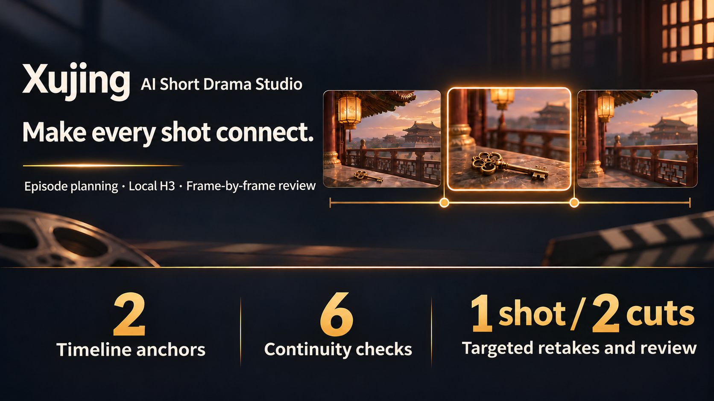

# Xujing · AI Short Drama Studio

[简体中文](README.md)

Xujing is a Windows desktop workspace for producing multi-episode AI short dramas. Plan scenes, build shot cards, render with a local MiniMax H3 service, and review the results against the episode's actual edit.

## What you can do

- **Continue from the actual edit.** Use the previous cut's out-frame and the next cut's in-frame as optional anchors for a replacement shot. See which take and frame supplied each anchor before submitting.
- **Catch continuity issues before rendering.** Compare the previous cut's final frame with the new shot's opening across six checks: blocking, eyeline, left hand, right hand, props and lighting. A local vision model suggests discrepancies and flags details it cannot see. The creator confirms the result.
- **Redo one shot and review the two adjacent cuts.** Watch the previous tail, current take and next opening together. Mark issues by frame and acceptance item. Keep approved neighboring shots in place and see whether a downstream shot still references the old take.

## How this fits alongside other tools

| Workflow | Publicly documented capabilities | Xujing's workflow |
| --- | --- | --- |
| Generate sequences | Kling 4.0 documents up to 30 seconds of native generation, up to 15 reference assets and up to 10 keyframe inputs. [Kling 4.0 launch](https://ir.kuaishou.com/news-releases/news-release-details/kling-ai-officially-launches-next-generation-kling-40-raising/) | Manage scenes, takes, selected cuts, running time and review tasks by episode. |
| Continue a shot | Runway Workflows extracts selected frames and can use the last frame of one clip to start the next generation. [Runway utility nodes](https://help.runwayml.com/hc/en-us/articles/47184761711379-Using-Utility-Nodes-in-Workflows) | Bind references to the cut's selected take and exact trim. Review the binding when that edit changes. |
| Close a gap or redo footage | LTX Desktop offers gap fill, retakes of selected ranges and switchable takes. [LTX Desktop generation guide](https://help.ltx.io/hc/en-us/articles/37088993051794-Generate-a-video-in-LTX-Desktop) | Track retakes by shot, review adjacent cuts independently and trace downstream references to earlier takes. |

## Turn on English

1. Open **Settings** (本机设置).
2. Under **Display language** (界面语言), choose **English**, then save.
3. Close and reopen Xujing. Select **简体中文** and reopen to switch back.

The choice is saved per workspace. Project titles, scripts, dialogue, asset names and saved prompts retain their original text. Raw service errors and some older generated notes may appear in their source language.

The CLI accepts `settings set --ui-language en-US` or `settings set --ui-language zh-CN`. `settings get` reports `uiLanguage`. This setting controls the desktop display language, while command names and the JSON contract remain stable.

## Workflow evidence

- In the *Balcony Key Handoff* sample, a local H3 render replaced one middle shot while preserving both neighbors. The two anchor frames corresponded to f0 and f140 of the middle shot.
- A mock-H3 verification used a frame f37 issue to replace the middle shot, review both adjacent cuts and export 216 frames at 24 fps. The run verified the workflow with controlled inputs.

This public repository showcases Xujing’s artwork and production workflow.
